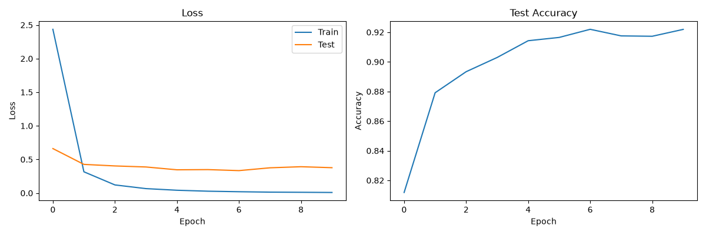
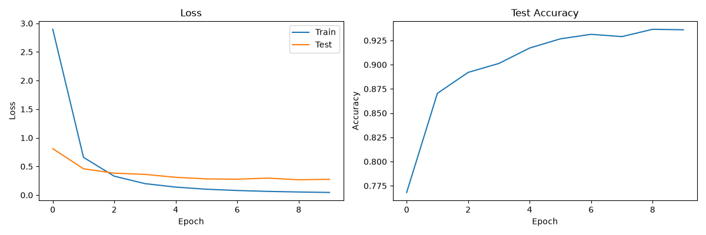
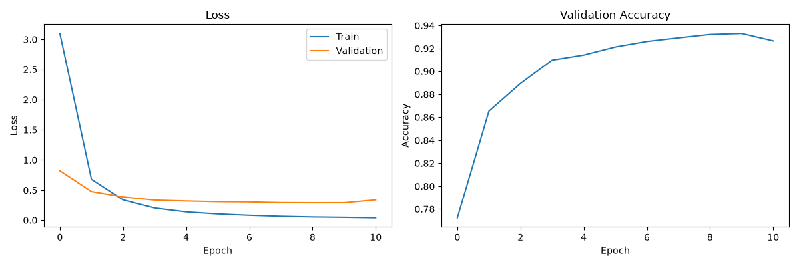
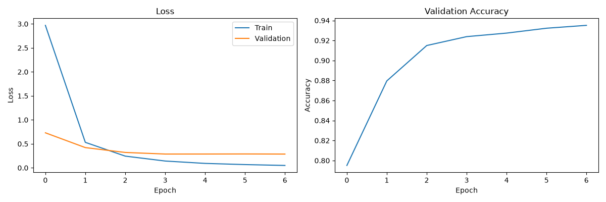
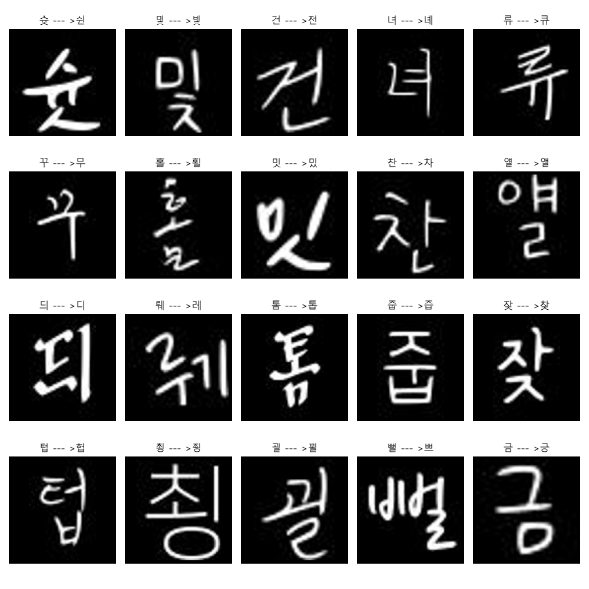

# Hangul Character Classification

A convolutional neural network in PyTorch that recognizes **2,350 Korean Hangul syllables** from single-character images. Trained on ~260,000 images, it reaches **~93.5% test accuracy** on a held-out test set that was used only once.

I built this as a learning project to understand the full deep learning workflow: loading and preprocessing image data, building a CNN, training on a GPU, evaluating honestly and analysing what the model gets wrong.

## Results

| Model | Input | Test accuracy |
|---|---|---|
| CNN, 3 conv blocks | 64×64 | ~92.2% * |
| + Dropout | 64×64 | ~93.7% * |
| + Validation set and early stopping | 64×64 | ~92.9% |
| Same model, higher resolution | 128×128 | ~75.8% |
| **4 conv blocks (final model)** | **128×128** | **~93.5%** |

Random guessing would be 1 / 2,350 ≈ 0.04%.

\* These two numbers come from an earlier 80/20 train/test split where I also used the test set to compare models, so they are slightly too optimistic. All later models use a separate validation set.

**Without dropout**: the training loss drops to almost 0 while the test loss starts rising again after epoch 6, so the model is memorizing the training data (overfitting).



**With dropout** (p = 0.5 before the final layer): the gap between training and test loss is smaller, the test loss stays flat and accuracy improves by ~1.5 percentage points (about 800 more correctly classified test images).



### Validation set and early stopping

The data is split 80% training / 10% validation / 10% test. After every epoch the model is evaluated on the validation set:

- The model with the **lowest validation loss** so far is saved to `model.pt`.
- Training **stops early** when the validation loss is not at least 0.001 lower than three epochs before.
- At the end, the best saved model is loaded and evaluated **once** on the test set.

With 64×64 input, training stopped after 11 epochs. The best validation accuracy was ~93.3%, the test accuracy **~92.9%**. That it is slightly lower than the validation accuracy is expected: the model was picked on the validation set, so only the test set gives an unbiased number.



### Resolution experiment: 64×64 → 128×128

The error analysis (see below) showed that most mistakes come down to a single small stroke. My hypothesis: at 64×64 these strokes are only 2–3 pixels wide, so a higher resolution should help.

**First attempt: only the input size changed.** Validation accuracy peaked at ~77% and early stopping ended training after 5 epochs, because the validation loss started rising while the training loss kept falling.


The experiment was not fair, because changing the input size also changed the model:

- After three 2×2 max-pools a 128×128 image is still 16×16, so the final linear layer grew from 8,192 to 32,768 inputs, about **77 million weights** in one layer. That makes memorizing the training data much easier.
- Three 3×3 conv layers only "see" a small part of a 128×128 image, so recognizing the overall structure of a syllable was left to the linear layer.

**Second attempt: a fourth conv block (256 channels).** Now the feature map is 8×8 again before the linear layer, just like with 64×64 input. Training stopped after 7 epochs and the final **test accuracy is ~93.5%**, about 0.6 percentage points (~150 test images) better than the 64×64 model.



Early stopping is based on the validation **loss**, not the accuracy. In the last epochs the accuracy still rose slightly while the loss stayed flat: the model gets a few more images right, but becomes more confident on the ones it gets wrong.

## Error analysis

`analyse.py` loads the best model, runs it on the test set and collects every misclassified image (~1,700 of 26,085 for the final model). It then counts the most frequent (true → predicted) pairs and plots a grid of examples.

| True | Predicted | Count | Difference |
|---|---|---|---|
| 잦 | 찾 | 8 | ㅈ / ㅊ (one stroke on top) |
| 꿜 | 뀔 | 5 | ㅞ / ㅟ |
| 챌 | 잴 | 4 | ㅊ / ㅈ |
| 뾔 | 뵈 | 4 | ㅃ / ㅂ (doubled consonant) |
| 며 | 머 | 4 | ㅕ / ㅓ (one short stroke) |
| 얀 | 안 | 4 | ㅑ / ㅏ (one short stroke) |
| 뷜 | 붤 | 4 | ㅟ / ㅝ |
| 뭇 | 믓 | 4 | ㅜ / ㅡ (one short stroke) |



What the errors have in common:

- **Almost always only one jamo is wrong**, the rest of the syllable is recognized correctly. The model has learned the structure of Hangul and fails on details.
- **The difference is usually a single short stroke**: plain vs. aspirated consonants (ㅈ/ㅊ, ㄷ/ㅌ), single vs. doubled consonants (ㅂ/ㅃ, ㄱ/ㄲ) and vowels with one stroke more or less (ㅓ/ㅕ, ㅏ/ㅑ).
- **No pair occurs more than 8 times.** The errors are spread over many different pairs, there is no single weak spot.
- **Some cases are ambiguous even for a human.** In fast handwriting a short stroke is often barely visible, and a few test images look closer to the predicted syllable than to their label, so part of the remaining error is probably handwriting ambiguity or label noise.

The higher resolution reduced the total number of errors slightly, but the **type of error stayed the same**. This suggests that most of the remaining mistakes are not caused by missing pixels.

## Dataset

[Hangul Characters 250k](https://www.kaggle.com/datasets/henryshippole/hangul-characters-250k) (Kaggle): 260,850 labeled images of 2,350 Hangul syllables, a mix of handwritten and printed characters. Labels come from `labels-map.csv` (image path → character).

Split: 80% training / 10% validation / 10% test (`random_split` with a fixed seed).

## Preprocessing

The raw images are 224×224 with a lot of empty border around the character. Simply resizing them to 64×64 made the characters unreadable, because the character itself ended up only ~20–30 pixels wide.

So each image is processed like MNIST:

1. Convert to grayscale
2. Crop to the bounding box of the character (`Image.getbbox()`)
3. Scale it into a 120×120 square **without distorting the aspect ratio** (`ImageOps.pad`)
4. Add a 4-pixel black border → 128×128
5. Scale pixel values from 0–255 to 0–1

(For the 64×64 models the character was scaled to 56×56 instead.)

Because this is slow, `preprocess.py` runs it **once** for all images and saves the result as a single tensor file (`data.pt`, uint8, ~4.3 GB at 128×128). Training then loads it straight into memory with a `TensorDataset` instead of opening 260k files every epoch.

## Model

```
Input 1×128×128
→ [Conv 3×3 (32)  → BatchNorm → ReLU → MaxPool 2×2]   → 32×64×64
→ [Conv 3×3 (64)  → BatchNorm → ReLU → MaxPool 2×2]   → 64×32×32
→ [Conv 3×3 (128) → BatchNorm → ReLU → MaxPool 2×2]   → 128×16×16
→ [Conv 3×3 (256) → BatchNorm → ReLU → MaxPool 2×2]   → 256×8×8
→ Flatten (16384) → Dropout(0.5) → Linear → 2350 classes
```

- **Conv2d**: slides small 3×3 filters over the image to detect local patterns: strokes and edges in the first layer, whole jamo like ㅇ or ㄱ in deeper layers.
- **BatchNorm**: normalizes the outputs of each layer, which makes training faster and more stable.
- **ReLU**: sets negative values to 0. Without this non-linearity, all layers together would just be one linear function.
- **MaxPool**: keeps only the largest value of every 2×2 area, halving the image size (128 → 64 → 32 → 16 → 8). Saves computation and makes the network less sensitive to small shifts.
- **Flatten**: turns the 256 feature maps of 8×8 into one vector of 16,384 values.
- **Dropout**: randomly switches off half of these values during training so the network can't rely on single features.
- **Linear**: combines all features into one score per character. The highest score is the prediction.

Training: Adam (lr = 0.001), cross-entropy loss, batch size 64, up to 40 epochs with early stopping on the validation loss, on an NVIDIA GPU with CUDA.

## What I learned

- **Look at your data before training.** My first resize made the characters unreadable. Only plotting a batch with its labels showed the problem.
- **Preprocessing matters as much as the model.** Cropping to the character and keeping the aspect ratio made the images clearly readable at 64×64.
- **Most training time was data loading, not the model.** Moving training to the GPU, loading with multiple workers and preprocessing everything once into a tensor file made training many times faster.
- **Overfitting is visible in the loss curves.** When the training loss keeps falling but the validation loss goes up, more epochs don't help. Dropout reduced this noticeably.
- **Train / validation / test.** At first I compared models and picked settings using the test set, which made the reported accuracy slightly too optimistic (93.7%). Now every decision (best epoch, when to stop) is made on a separate validation set, and the test set is used only once at the end.
- **Look at the errors, not just the accuracy.** The error analysis showed *what kind* of mistakes the model makes, which led to a concrete hypothesis to test.
- **Change one thing at a time, and let the rest of the model grow with it.** Doubling the input size without adjusting the network made the model much worse. Only after adding a conv block was the comparison fair.
- **Read shape errors.** In `mat1 and mat2 shapes cannot be multiplied (64x256 and 16384x2350)` the 256 is what actually arrives at the linear layer and the 16384 is what it expects.

## How to run

```bash
python -m venv venv
source venv/Scripts/activate          # Windows (Git Bash)
pip install torch torchvision --index-url https://download.pytorch.org/whl/cu132   # CUDA build
pip install pandas pillow matplotlib
```

Download the dataset from Kaggle and place it in `hangul_characters_250k/` (with `labels-map.csv` inside). Then:

```bash
python main.py      # preprocess (first run only) and train
python analyse.py   # error analysis of the saved model
```

On the first run, `preprocess.py` creates `data.pt` (needs ~4.3 GB of RAM to load). The best model (lowest validation loss) is saved as `model.pt` and the training curves in `images/`.

## Next steps

- Data augmentation (small rotations and shifts)
- Test on my own handwriting

This Readme was enhanced with AI
