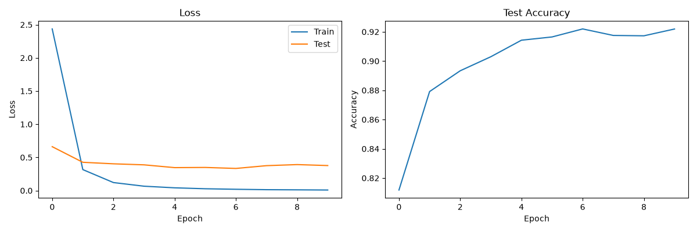
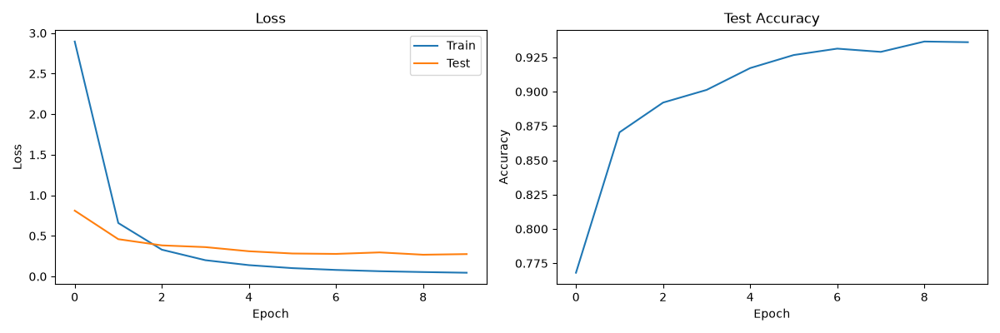

# Hangul Character Classification

A convolutional neural network in PyTorch that recognizes **2,350 Korean Hangul syllables** from single-character images. Trained on ~260,000 images, it reaches **~93.7% test accuracy**.

I built this as a learning project to understand the full deep learning workflow: loading and preprocessing image data, building a CNN, training on a GPU and evaluating honestly.

## Results

| Model | Test accuracy | Test loss (final epoch) |
|---|---|---|
| CNN | ~92.2% | ~0.38 (rising again) |
| CNN + Dropout | **~93.7%** | **~0.28 (stable)** |

Random guessing would be 1 / 2,350 ≈ 0.04%.

**Without dropout**: the training loss drops to almost 0 while the test loss starts rising again after epoch 6, so the model is memorizing the training data (overfitting).



**With dropout** (p = 0.5 before the final layer): the gap between training and test loss is smaller, the test loss stays flat and accuracy improves by ~1.5 percentage points (about 800 more correctly classified test images).



## Dataset

[Hangul Characters 250k](https://www.kaggle.com/datasets/henryshippole/hangul-characters-250k) (Kaggle): 260,850 labeled images of 2,350 Hangul syllables, a mix of handwritten and printed characters. Labels come from `labels-map.csv` (image path → character).

Split: 80% training / 20% test (`random_split` with a fixed seed).

## Preprocessing

The raw images are 224×224 with a lot of empty border around the character. Simply resizing them to 64×64 made the characters unreadable, because the character itself ended up only ~20–30 pixels wide.

So each image is processed like MNIST:

1. Convert to grayscale
2. Crop to the bounding box of the character (`Image.getbbox()`)
3. Scale it into a 56×56 square **without distorting the aspect ratio** (`ImageOps.pad`)
4. Add a 4-pixel black border → 64×64
5. Scale pixel values from 0–255 to 0–1

Because this is slow, `preprocess.py` runs it **once** for all images and saves the result as a single tensor file (`data.pt`, uint8). Training then loads it straight into memory with a `TensorDataset` instead of opening 260k files every epoch.

## Model

```
Input 1×64×64
→ [Conv 3×3 (32)  → BatchNorm → ReLU → MaxPool 2×2]   → 32×32×32
→ [Conv 3×3 (64)  → BatchNorm → ReLU → MaxPool 2×2]   → 64×16×16
→ [Conv 3×3 (128) → BatchNorm → ReLU → MaxPool 2×2]   → 128×8×8
→ Flatten (8192) → Dropout(0.5) → Linear → 2350 classes
```

- **Conv2d**: slides small 3×3 filters over the image to detect local patterns: strokes and edges in the first layer, whole jamo like ㅇ or ㄱ in deeper layers.
- **BatchNorm**: normalizes the outputs of each layer, which makes training faster and more stable.
- **ReLU**: sets negative values to 0. Without this non-linearity, all layers together would just be one linear function.
- **MaxPool**: keeps only the largest value of every 2×2 area, halving the image size (64 → 32 → 16 → 8). Saves computation and makes the network less sensitive to small shifts.
- **Flatten**: turns the 128 feature maps of 8×8 into one vector of 8,192 values.
- **Dropout**: randomly switches off half of these values during training so the network can't rely on single features.
- **Linear**: combines all features into one score per character. The highest score is the prediction.

Training: Adam (lr = 0.001), cross-entropy loss, batch size 64, 10 epochs, on an NVIDIA GPU with CUDA.

## What I learned

- **Look at your data before training.** My first resize made the characters unreadable. Only plotting a batch with its labels showed the problem.
- **Preprocessing matters as much as the model.** Cropping to the character and keeping the aspect ratio made the images clearly readable at 64×64.
- **Most training time was data loading, not the model.** Moving training to the GPU, loading with multiple workers and preprocessing everything once into a tensor file made training many times faster.
- **Overfitting is visible in the loss curves.** When the training loss keeps falling but the test loss goes up, more epochs don't help. Dropout reduced this noticeably.
- **Train / validation / test.** I compared models and picked settings using the test set. Properly, decisions should be made on a separate validation set, and the test set used only once at the end, otherwise the reported accuracy is slightly too optimistic.

## How to run

```bash
python -m venv venv
source venv/Scripts/activate          # Windows (Git Bash)
pip install torch torchvision --index-url https://download.pytorch.org/whl/cu132   # CUDA build
pip install pandas pillow matplotlib
```

Download the dataset from Kaggle and place it in `hangul_characters_250k/` (with `labels-map.csv` inside). Then:

```bash
python main.py
```

On the first run, `preprocess.py` creates `data.pt`. The trained model is saved as `model.pt` and the training curves in `images/`.

## Next steps

- Separate validation set and keep the best epoch (early stopping)
- Data augmentation (small rotations and shifts)
- Error analysis: which characters get confused most?
- Test on my own handwriting


This Readme was enhanced with AI